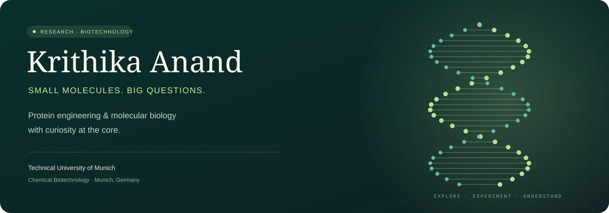
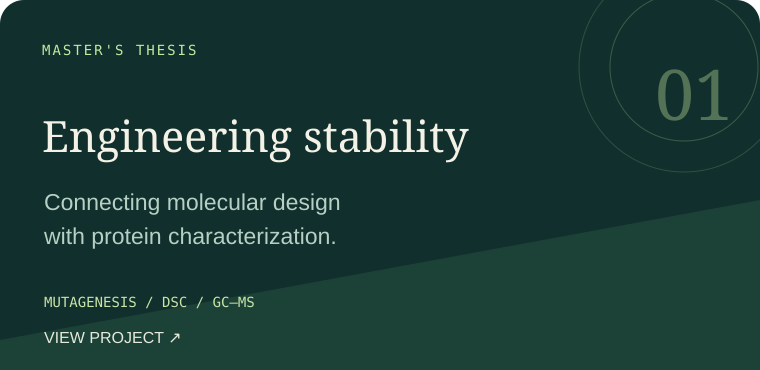
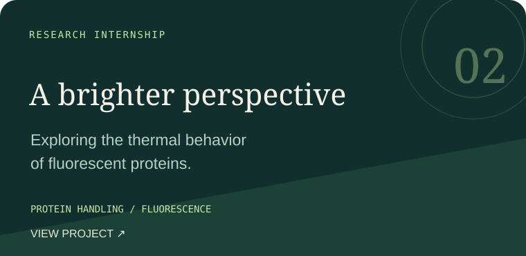
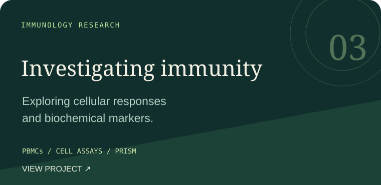

  

### [🌿 PORTFOLIO](https://krithikaanand14.github.io/) &nbsp; / &nbsp; [💼 LINKEDIN](https://linkedin.com/in/krithikaanandofficial) &nbsp; / &nbsp; [✉️ CONTACT](mailto:krithikaanand19@gmail.com)

**PROTEIN SCIENCE** &nbsp; ✦ &nbsp; **MOLECULAR BIOLOGY** &nbsp; ✦ &nbsp; **EXPERIMENTAL DESIGN**

 

## A little about the scientist

I'm **Krithika Anand**, an M.Sc. Chemical Biotechnology student at the **Technical University of Munich**, based in Munich, Germany.

I work at the intersection of **protein engineering, molecular biology, and biochemical characterization**. I enjoy turning a question into an experiment, troubleshooting at the bench, and finding the story in the data.

> **My approach:** Ask carefully. Experiment thoughtfully. Document clearly.

 

## Selected research

**01 / Enzyme engineering** — Molecular cloning, recombinant expression, purification, and thermal and functional characterization of a terpene synthase.

**02 / Fluorescent protein stability** — Formulation screening and fluorescence-based investigation of protein behavior under thermal stress.

**03 / Vaccine immune response** — PBMC handling, peptide-stimulation assays, biochemical measurements, and data analysis.

Project repositories contain high-level summaries. Unpublished results, experimental designs, and internal laboratory details are excluded.

 

## From the bench to the data

| 🧬 Build & express | 🧪 Measure & characterize | 📊 Interpret & document |
| :--- | :--- | :--- |
| Molecular cloning | FPLC purification | GraphPad Prism |
| Site-directed mutagenesis | GC–MS & DSC | MS Excel & Google Colab |
| Recombinant protein expression | ELISA & western blot | Experimental records |
| Microbial culture & aseptic handling | Spectrophotometry | Comparative data interpretation |

 

## The journey so far

**TUM · Germany**  
M.Sc. Chemical Biotechnology · Research experience at Campus Garching and Campus Straubing

**Rajalakshmi Engineering College · India**  
B.Tech. Biotechnology

**University of Madras & MGM Healthcare · India**  
Earlier laboratory experience in immune-response assays and clinical microbiology

<b>📖 Explore my publication</b>

 

**Strategies for enhancing the efficacy of anaerobic digestion of food industry wastewater: An insight into bioreactor types, challenges, and future scope.**

*Chemosphere*, 2023 · [Read the publication ↗](https://www.sciencedirect.com/science/article/abs/pii/S0045653522033495)

 

**Interested in research opportunities and scientific collaboration.**

[Explore my work](https://krithikaanand14.github.io/) &nbsp; · &nbsp; [Let's connect on LinkedIn](https://linkedin.com/in/krithikaanandofficial)

Curiosity, carried forward.

